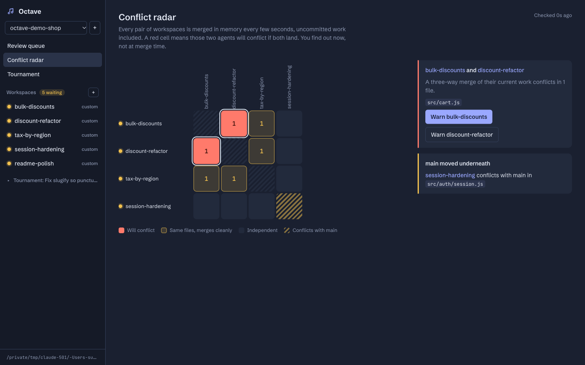
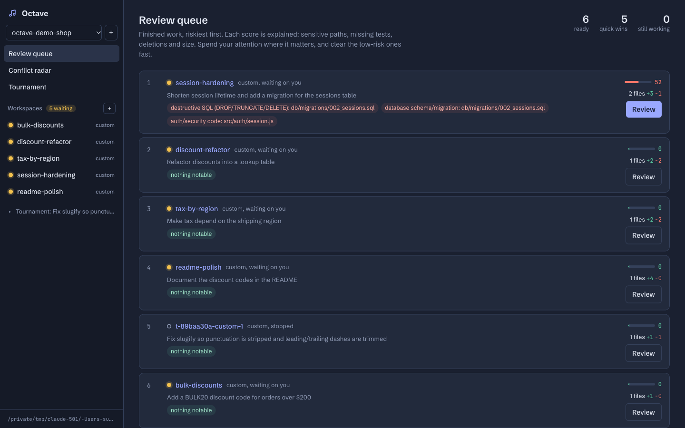
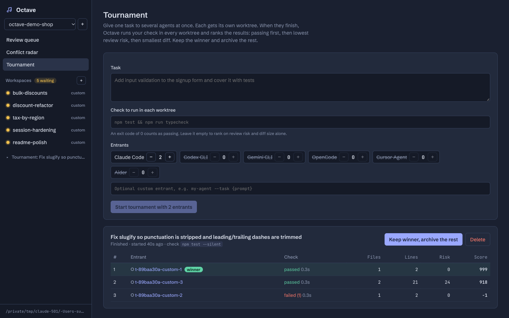
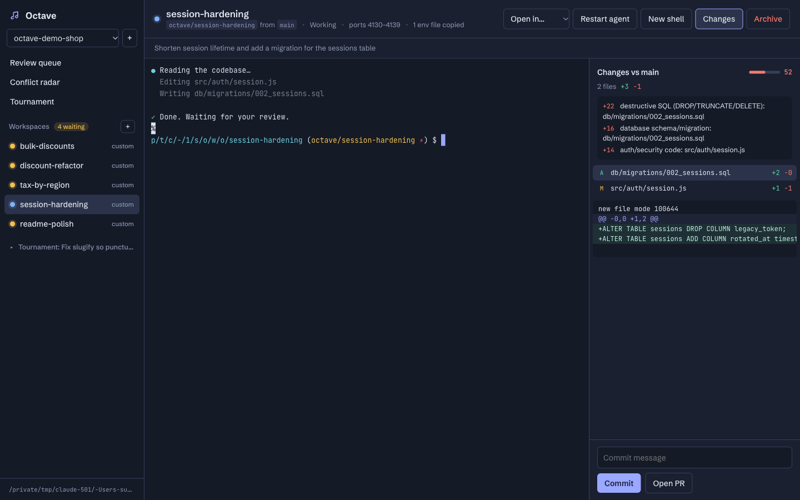

# Octave

**Run a fleet of coding agents in parallel without them stepping on each other.**

Octave gives every agent its own git worktree, ports and env files, like other parallel-agent tools do. It then solves three problems that appear once you run more than two or three agents:

| Problem | What Octave does |
|---|---|
| Two agents rewrite the same code, and you only find out at merge time. | **Conflict Radar** merges every pair of live workspaces in memory every few seconds, uncommitted work included, and shows which ones *will* conflict. One click sends the agent a heads-up. |
| Ten finished diffs, and you don't know where to start. | **Review Queue** gives each diff an explainable risk score (destructive SQL, auth, CI, lockfiles, missing tests, deletions, size) and orders your review. |
| "Was it worth paying for five agents?" | **Tournament** gives one task to N agents, runs your tests in every worktree, and ranks the results by pass, risk, then diff size. Keep the winner and archive the rest. |



## Quick start

```bash
npm install
npm start            # builds the UI and serves http://localhost:7420
```

To see every feature without any API keys, open a second terminal and run:

```bash
npm run demo         # seeds a demo repo with scripted agents and a tournament
```

Then add your own repo from the UI and start Claude Code, Codex, Gemini CLI, OpenCode, Cursor Agent, Aider, or any command (`my-agent --task {prompt}`).

Requirements: Node 20+ and git 2.38+. Runs on macOS and Linux, and on Windows via PowerShell, because the UI is just a browser tab.

## Features

**Core**
- One git worktree and one branch (`octave/<task>`) per workspace. Archiving removes both.
- A real PTY per workspace (node-pty → WebSocket → xterm.js), with 512 KB of scrollback replayed on reconnect.
- Live status: *working*, *waiting on you* or *stopped*, plus a desktop notification and a tab-title badge when an agent starts waiting.
- Live diff against the base branch, covering commits, uncommitted edits and new files. Commit, or push and open a PR with `gh`, from the side panel.
- Open any worktree in Cursor, VS Code, Zed or the file manager.

**Zero-config setup** (no setup script to write)
- **Port allocator:** each workspace gets a free, reserved block of 10 ports, exported as `PORT` and `OCTAVE_PORT_0…9` and written to `.env.octave`. Ten dev servers, zero collisions.
- **Env copy:** gitignored `.env*` files are copied from your main checkout into each new worktree, since `git worktree add` leaves them behind.
- **Dependency install:** Octave detects pnpm, bun, yarn, npm, uv, poetry, pip, cargo, go or bundler and installs before the agent starts. A `.octave/setup.sh` in the repo overrides this.

**Conflict Radar:** pairwise `git merge-tree --write-tree` between workspace snapshots, plus each workspace against the base branch so you see when `main` moved underneath you.

**Review Queue:** explainable scoring. Every point comes with a reason. Running workspaces sink until they finish, and tournament entrants only appear through their winner.

**Tournament:** entrants run headless (`claude -p`, `codex exec`, `gemini -p` and so on). When the last one exits, the check runs in every worktree and the leaderboard shows pass/fail, files, lines, risk and score.

| | |
|---|---|
|  |  |
|  | |

## How it works

```
browser (React + xterm.js)
   │  REST /api/*         WebSocket /ws/events (state push) + /ws/term/:id (PTY)
   ▼
Node server (Express + ws), bound to 127.0.0.1
   ├─ SessionManager    node-pty per workspace, scrollback, activity-based status
   ├─ Octave            projects, workspaces, diff cache, radar, triage, tournaments
   ├─ git.ts            worktrees, snapshots, numstat diffs, merge-tree predictions
   ├─ risk.ts           explainable risk scoring (pure, unit-tested)
   ├─ ports.ts          port-block allocator with live probing
   └─ Store             ~/.octave/state.json (atomic writes, corruption-safe)
```

**The snapshot trick.** To diff or merge work the agent hasn't committed, Octave builds a commit from the worktree with a *throwaway index* (`GIT_INDEX_FILE` → `read-tree HEAD` → `add -A` → `write-tree` → `commit-tree`). The agent's real index and files are never touched. Dates are pinned, so the same content always gives the same SHA. That makes snapshots content-addressed, so diff and merge results are cached across polls and the radar only recomputes pairs that actually changed.

**Security.** The server can spawn shells, so it binds to loopback only and rejects any request or WebSocket whose `Host` or `Origin` isn't local. That blocks DNS-rebinding and cross-site WebSocket hijacking from a malicious web page. Agent shells get a clean environment, with package-manager and Octave-internal variables stripped.

## Development

```bash
npm run dev          # server (tsx watch) + Vite dev server on :5173
npm test             # vitest: real git repos + real PTYs, no mocks
npm run typecheck
```

State lives in `~/.octave` (override with `OCTAVE_HOME`). The port defaults to 7420 (`OCTAVE_PORT`).

## Notes

- Claude Code asks you to trust each new folder the first time it runs there. Octave intentionally doesn't bypass this; it's your security decision.
- Octave is an independent, clean-room project. It shares no code with any other product.

MIT licensed.
