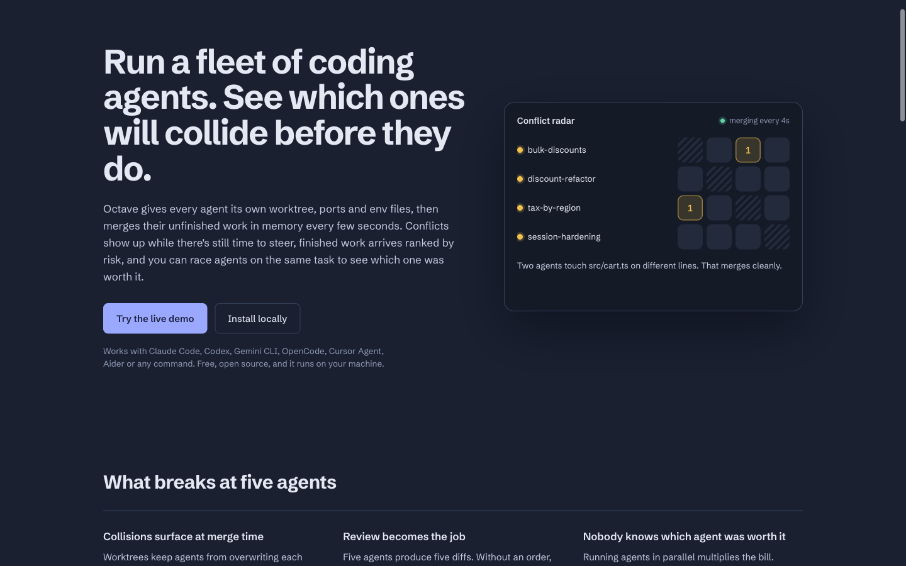
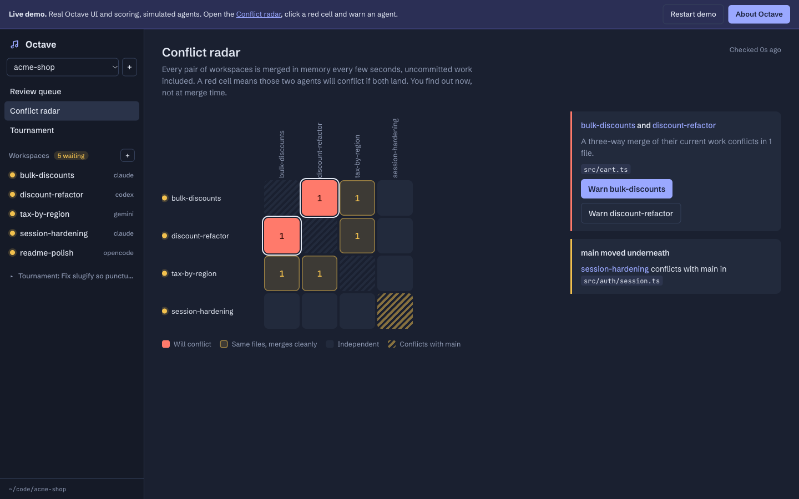
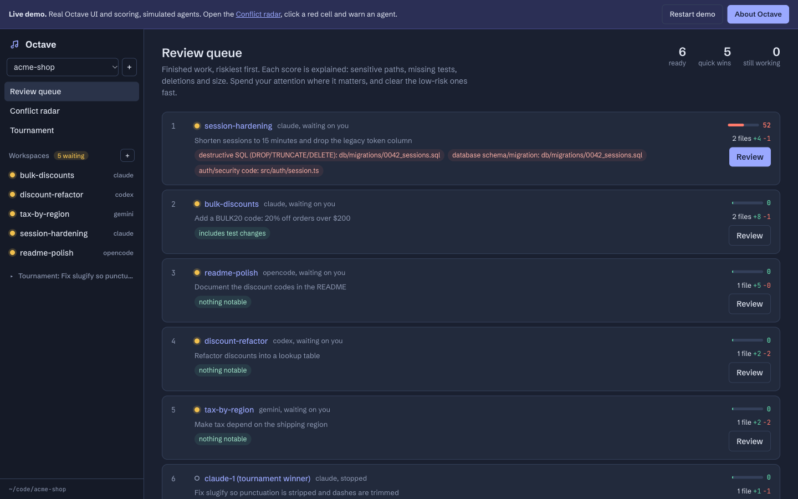
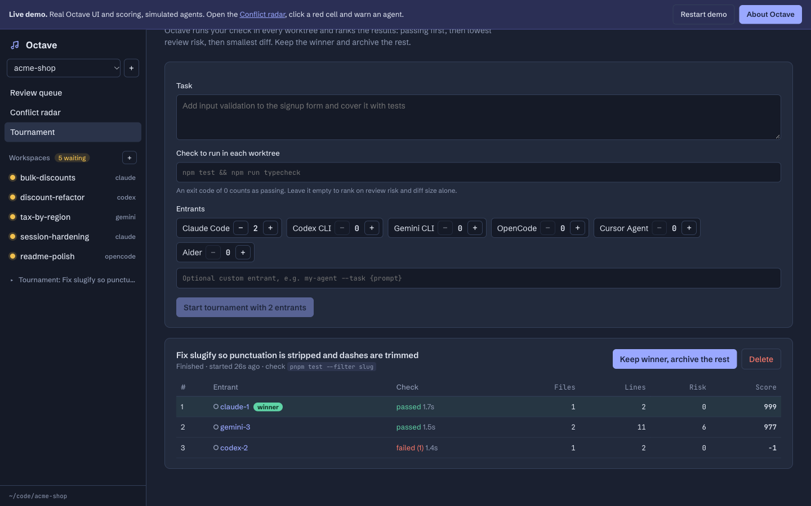
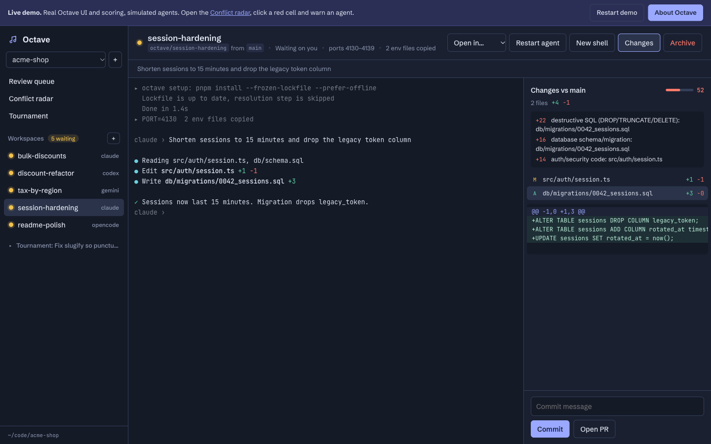
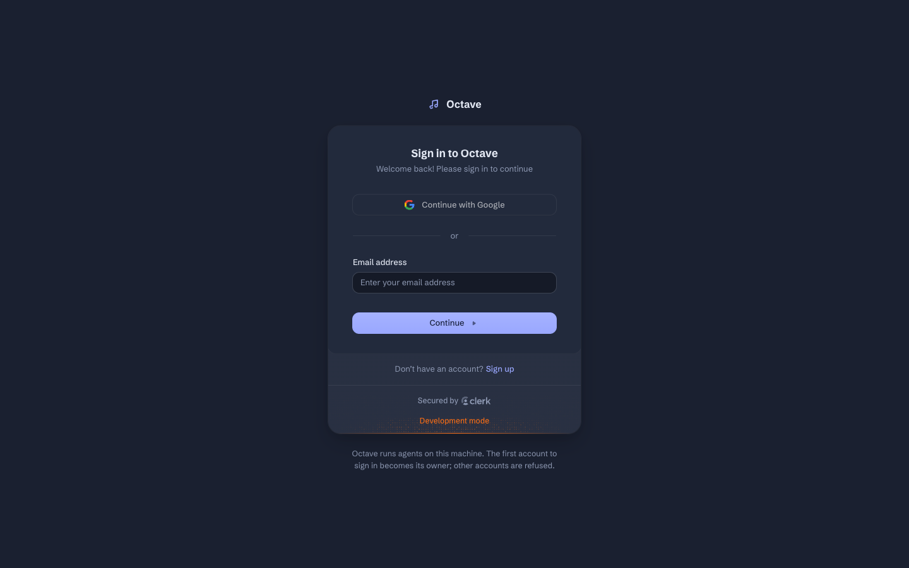

# Octave

[](https://github.com/codewithsupra/octave/actions/workflows/ci.yml)

**Run a fleet of coding agents in parallel without them stepping on each other.**

**Live demo:** [octave-roan.vercel.app/demo](https://octave-roan.vercel.app/demo). No install and no keys; it's the real UI and scoring, driven by simulated agents.

Octave gives every agent its own git worktree, ports and env files, like other parallel-agent tools do. It then solves three problems that appear once you run more than two or three agents:

| Problem | What Octave does |
|---|---|
| Two agents rewrite the same code, and you only find out at merge time. | **Conflict Radar** merges every pair of live workspaces in memory every few seconds, uncommitted work included, and shows which ones *will* conflict. One click sends the agent a heads-up. |
| Ten finished diffs, and you don't know where to start. | **Review Queue** gives each diff an explainable risk score (destructive SQL, auth, CI, lockfiles, missing tests, deletions, size) and orders your review. |
| "Was it worth paying for five agents?" | **Tournament** gives one task to N agents, runs your tests in every worktree, and ranks the results by pass, risk, then diff size. Keep the winner and archive the rest. |





## Try it in 10 seconds

Open **`/demo`**. It's the real Octave UI and the real risk and ranking code, driven by simulated agents in your browser. No install, no keys. Open the Conflict radar, click a red cell, and warn an agent: it moves its change and the conflict clears.

## Quick start

```bash
npm install
cp .env.example .env.local   # or: clerk env pull
npm start                    # builds the UI and serves http://localhost:7420
```

| Route | What it is |
|---|---|
| `/` | Landing page |
| `/demo` | Interactive demo (fully client-side) |
| `/sign-in`, `/sign-up` | Clerk |
| `/app` | Your Octave: real worktrees, real agents |

To seed your local install with scripted agents and a tournament on a sample repo:

```bash
npm run demo
```

Then add your own repo from the UI and start Claude Code, Codex, Gemini CLI, OpenCode, Cursor Agent, Aider, or any command (`my-agent --task {prompt}`).

Requirements: Node 20+ and git 2.38+. Tested in CI on macOS and Linux. Windows isn't supported yet, because the integration tests and the hook script assume a POSIX shell.

## Features

**Core**
- One git worktree and one branch (`octave/<task>`) per workspace. Archiving removes both.
- A real PTY per workspace (node-pty → WebSocket → xterm.js), with 512 KB of scrollback replayed on reconnect.
- Live status: *working*, *waiting on you* or *stopped*, plus a desktop notification and a tab-title badge when an agent starts waiting.
- Live diff against the base branch, covering commits, uncommitted edits and new files. Commit, or push and open a PR with `gh`, from the side panel.
- Open any worktree in Cursor, VS Code, Zed or the file manager.

**Zero-config setup** (no setup script to write)
- **Port allocator:** each workspace gets a free, reserved block of 10 ports, exported as `PORT` and `OCTAVE_PORT_0…9` and written to `.env.octave`. Ten dev servers, zero collisions.
- **Env copy:** gitignored `.env*` files are copied from your main checkout into each new worktree, since `git worktree add` leaves them behind.
- **Dependency install:** Octave detects pnpm, bun, yarn, npm, uv, poetry, pip, cargo, go or bundler and installs before the agent starts. A `.octave/setup.sh` in the repo overrides this.

**Conflict Radar:** pairwise `git merge-tree --write-tree` between workspace snapshots, plus each workspace against the base branch so you see when `main` moved underneath you.

**Review Queue:** explainable scoring. Every point comes with a reason. Running workspaces sink until they finish, and tournament entrants only appear through their winner.

**Tournament:** entrants run headless (`claude -p`, `codex exec`, `gemini -p` and so on). When the last one exits, the check runs in every worktree and the leaderboard shows pass/fail, files, lines, risk and score.

| | |
|---|---|
|  |  |
|  |  |

## Real agents: Claude Code, Codex, Cursor

Octave runs each agent's own CLI in a real terminal inside the workspace's worktree, using your own login and subscription. Nothing is proxied. Install and log in once, and Octave detects it on your PATH:

| Agent | Install | Log in | Status source |
|---|---|---|---|
| Claude Code | `npm i -g @anthropic-ai/claude-code` | run `claude` once | **hooks**: working, needs approval, finished (with last message) |
| Codex | `npm i -g @openai/codex` | run `codex` once | **hooks**: turn finished (with last message). Verified with codex-cli 0.162 |
| Cursor | Cursor's CLI installer (`cursor-agent`, or the newer `agent`) | `cursor-agent login` | hooks where the CLI fires them; activity otherwise |
| Gemini, OpenCode, Aider, custom | their own installers | their own | activity (terminal output) |

**Lifecycle hooks.** Octave writes a small observe-only hook config into every new worktree:
- Claude Code: `.claude/settings.local.json`, using `UserPromptSubmit`, `PostToolUse`, `Notification`, `Stop` and `StopFailure`.
- Cursor: `.cursor/hooks.json`, using `sessionStart`, `postToolUse` and `stop`.
- Codex: a per-run `-c notify=[…]` flag, so no file is written.

Each hook calls `~/.octave/hooks/octave-hook.sh`. The script posts the event to Octave with that workspace's own secret, is silent, gives up after 2 seconds, and **always exits 0**, so it can never block or steer the agent. It's a no-op if you run the agent outside Octave. The generated files never appear in diffs, and a hook file your repo already tracks is left untouched.

Once an agent reports through a hook, hooks own its status. A long, silent test run stays *Working*, a permission prompt becomes *Needs your approval* with the exact request shown and a desktop notification, and a finished turn shows the agent's last message. Agents without hooks fall back to activity-based status.

## How it works

```
browser (React + xterm.js)
   │  REST /api/*         WebSocket /ws/events (state push) + /ws/term/:id (PTY)
   ▼
Node server (Express + ws), bound to 127.0.0.1
   ├─ SessionManager    node-pty per workspace, scrollback, activity-based status
   ├─ Octave            projects, workspaces, diff cache, radar, triage, tournaments
   ├─ git.ts            worktrees, snapshots, numstat diffs, merge-tree predictions
   ├─ risk.ts           explainable risk scoring (pure, unit-tested)
   ├─ ports.ts          port-block allocator with live probing
   └─ Store             ~/.octave/state.json (atomic writes, corruption-safe)
```

**The snapshot trick.** To diff or merge work the agent hasn't committed, Octave builds a commit from the worktree with a *throwaway index* (`GIT_INDEX_FILE` → `read-tree HEAD` → `add -A` → `write-tree` → `commit-tree`). The agent's real index and files are never touched. Dates are pinned, so the same content always gives the same SHA. That makes snapshots content-addressed, so diff and merge results are cached across polls and the radar only recomputes pairs that actually changed.

**Auth (Clerk).** When Clerk keys are present, every `/api` route and WebSocket requires a valid session token. Tokens are verified server-side and must be minted for Octave's own origin (`authorizedParties`). Browsers can't set headers on a WebSocket and tokens don't belong in URLs, so sockets authenticate with their first message. Signing in isn't enough by itself: the **first account to sign in becomes the owner**, and every other account gets a 403, unless it's listed in `OCTAVE_ALLOWED_USERS`. That matters because this server runs shells. With `OCTAVE_PUBLIC_URL` set, Octave can serve a remote machine, but it refuses to start that way without Clerk. Without keys, Octave runs in local-only mode.

**Security.** The server can spawn shells, so by default it binds to loopback only and rejects any request or WebSocket whose `Host` or `Origin` isn't local. That blocks DNS-rebinding and cross-site WebSocket hijacking from a malicious web page. `/api` and the agent hook endpoint are rate limited, and a client that sends 20 bad hook secrets gets throttled. Agent shells get a clean environment, with package-manager and Octave-internal variables stripped.

The design decisions, the full security model and the plan for team use are in [docs/ARCHITECTURE.md](docs/ARCHITECTURE.md).

## Deploying the landing page and demo

The landing page and `/demo` need no server. `vercel.json` builds them as a static site, where `/app` explains how to install. The app itself always runs on your own machine.

## Development

```bash
npm run dev            # server (tsx watch) + Vite dev server on :5173
npm test               # 55 Vitest tests: unit + integration on real git repos, PTYs, HTTP and WebSockets
npm run test:coverage  # same, with coverage thresholds (lines >= 80%, branches >= 70%)
npm run build && npm run test:e2e   # 22 Playwright tests incl. axe WCAG 2.1 A/AA scans
BASE_URL=https://octave-roan.vercel.app npm run test:e2e   # same suite against the live deploy
npm run smoke:agents   # opt-in: real Claude Code / Codex / Cursor runs (uses your logins)
npm run typecheck
```

| Suite | Count | What it covers |
|---|---|---|
| Unit + integration (Vitest) | 55 | scoring engines, git snapshots and merge prediction, PTYs, hooks, the real HTTP/WebSocket server with Clerk token verification, rate limits |
| Browser end to end (Playwright) | 22 | landing page, route code splitting, full demo flows, phone-width layout |
| Accessibility (axe-core) | 5 of the 22 | WCAG 2.1 A/AA on the landing page and all demo views |
| Coverage | 85% lines, 80% branches | `server/` and the demo simulator |

CI ([.github/workflows/ci.yml](.github/workflows/ci.yml)) runs typecheck, tests with coverage thresholds and the build on Ubuntu and macOS, plus the Playwright suite on Ubuntu.

State lives in `~/.octave` (override with `OCTAVE_HOME`). The port defaults to 7420 (`OCTAVE_PORT`).

## Notes

- Claude Code asks you to trust each new folder the first time it runs there. Octave intentionally doesn't bypass this; it's your security decision.
- Octave is an independent, clean-room project. It shares no code with any other product.

MIT licensed.
